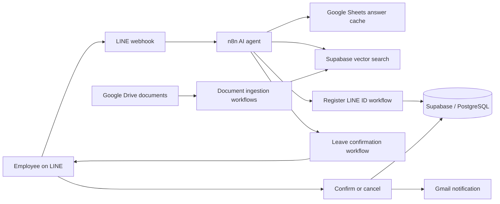

# HR Self-Service Chatbot with RAG

**An n8n workflow project connecting LINE, AI-assisted document search, and HR self-service.**

`n8n` · `LINE Messaging API` · `OpenAI` · `Supabase` · `PostgreSQL` · `Google Drive` · `Gmail`

## Overview

This project was developed during my software developer co-operative education placement. It explores how an HR team can automate common employee enquiries and leave workflows through a LINE chatbot. An AI agent retrieves relevant information from a document knowledge base and connects to tools for employee registration and leave requests.

The workflows are shared as a **portfolio reference**. The exports have been sanitized and require configuration, database objects, credentials, and testing before they can be used. They are not a ready-to-deploy HR system.

## Features

- **HR questions with RAG:** retrieves relevant document content from a Supabase vector store for the AI agent to use in responses.
- **Knowledge-base maintenance:** Google Drive triggers handle created and updated documents; a separate deletion flow archives the corresponding record. Review and adapt document and vector cleanup for your data model.
- **Answer cache:** Google Sheets tools provide a cache for previously answered questions.
- **Employee self-service:** supports linking a LINE account to an employee record and retrieving employee or leave information.
- **Leave confirmation:** sends a LINE Flex Message for the employee to review before the main workflow processes the confirmation.
- **Leave processing:** the confirmation path updates leave balance, records a request, sends an HR email, and replies through LINE.

## Workflow at a glance

The diagram is a conceptual overview; see the individual n8n nodes for the actual routing and conditions.

## Repository contents

| File | Purpose |
| --- | --- |
| [`workflows/hr-system.json`](workflows/hr-system.json) | Main LINE webhook, AI agent, document ingestion, and leave processing workflow |
| [`workflows/leave-confirmation.json`](workflows/leave-confirmation.json) | Validates employee and leave inputs and sends a confirmation message |
| [`workflows/register-line-id.json`](workflows/register-line-id.json) | Links a LINE ID to an employee record |

The original `.env`, Docker Compose configuration, n8n runtime data, local files, credentials, and document contents are not included. Workflow exports are inactive and contain placeholders or empty selections for instance-specific resources.

## Getting started

1. Set up a compatible n8n instance and review the imported nodes for version compatibility. Configure appropriate credentials for OpenAI, Supabase, PostgreSQL, Google Drive, Google Sheets, Gmail, and the LINE Messaging API as required by each node.
2. Import the three JSON files through the n8n workflow editor. Import the two sub-workflows first, then the main workflow. Keep them inactive while configuring and testing.
3. In the main workflow, select the imported **Leave Confirmation Tool** and **Register LineID** workflows in their corresponding tool nodes. Reconnect credentials on all nodes. Select your own Drive folders and Sheets document/sheet in the affected nodes, and replace `REPLACE_WITH_HR_EMAIL` in **Send HR Email**.
4. Provision your own Supabase/PostgreSQL tables, vector extension and similarity-search function. The workflows reference resources such as `employee`, `documents`, `chat_history`, and `match_documents`, plus leave-related tables and fields. This repository does **not** include the full database schema, migration scripts, sample HR documents, or seed data; inspect the nodes and create a compatible schema before testing.
5. Configure the LINE webhook URL and channel credentials for your own bot. Review the webhook path, callback handling and security before activating. Enable and test the sub-workflows and main workflow in a controlled environment.
6. Test with synthetic records: document creation/update/deletion handling, account registration, leave balance lookup, leave confirmation and cancellation, error paths, database updates, and email delivery. Verify document and vector synchronization against your own requirements.

## Before real-world use

Review LINE webhook signature verification, authentication and authorization, employee identity verification, least-privilege access, privacy, error handling, and audit logging. In particular, validate leave balances and concurrent requests on the server and make balance updates and leave records atomic; the exported sequential nodes alone should not be assumed to provide transactional or replay protection. Review AI output and RAG data handling before exposing company documents or employee information.

## Author

**Supanut Jantarangsee** · [GitHub](https://github.com/SnowvyTH)
